# LAPORAN PRAKTIKUM 5 JAVASCRIPT

<h1>Nama        : Eka Sari Praditya</h1>
<h1>NIM         : 312510021</h1>
<h1>Kelas       : I253A</h1>
<h1>Mata Kuliah : Pemrogramman Web</h1>

# Latihan 1
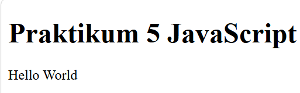

# Latihan 2
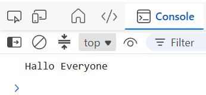
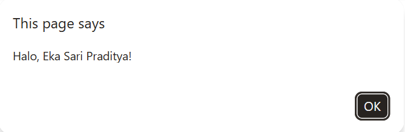

# Latihan 3
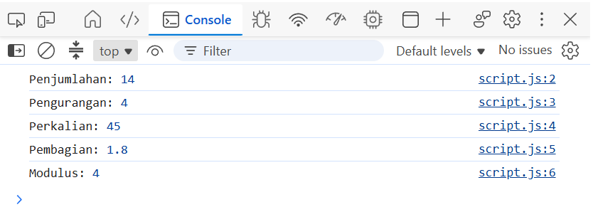

# Latihan 4
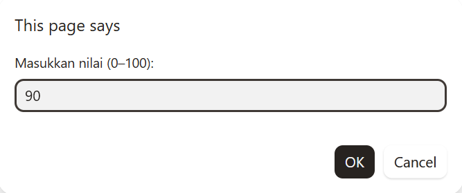
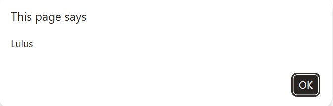
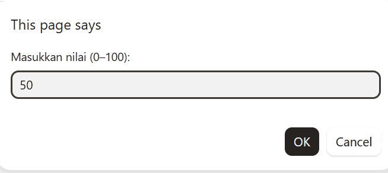
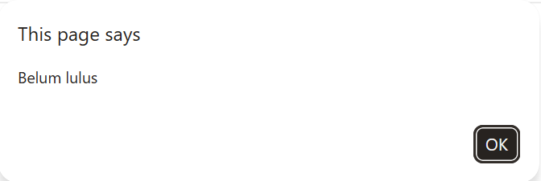

# Latihan 5
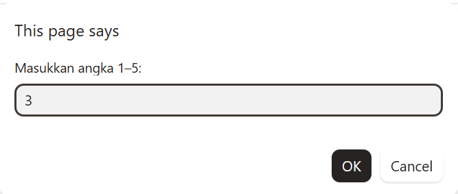
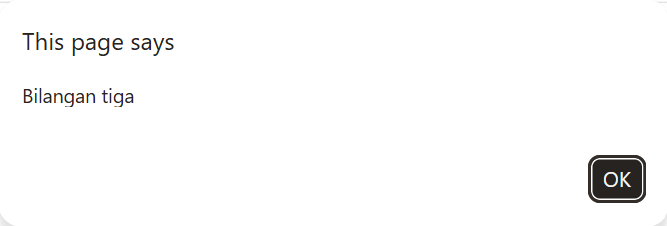

# Latihan 6
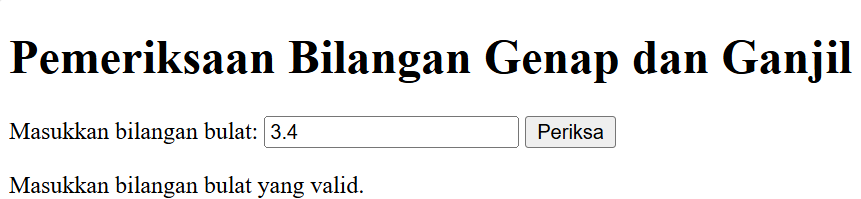

# Latihan 7 
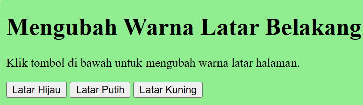

# Latihan 8
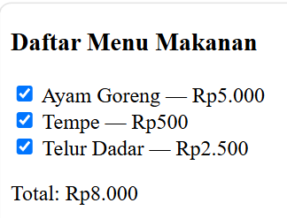

# Mini Project — Kalkulator Nilai Mahasiswa

# Eksperimen Mandiri
<h4>Ubah Latihan 3 agar menerima dua nilai dari prompt dan mengonversinya menjadi number</h4>

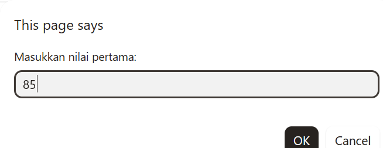
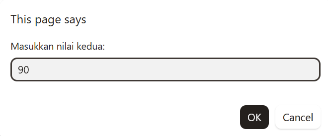
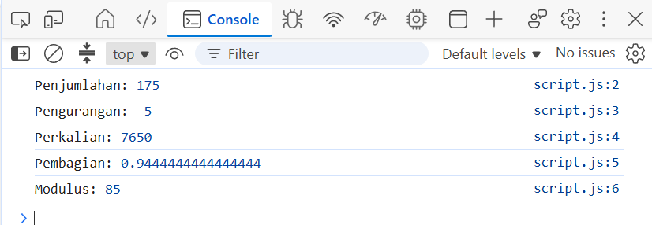

<h4>Buat perulangan untuk menampilkan tabel perkalian angka 7 dari 1 sampai 10</h4>

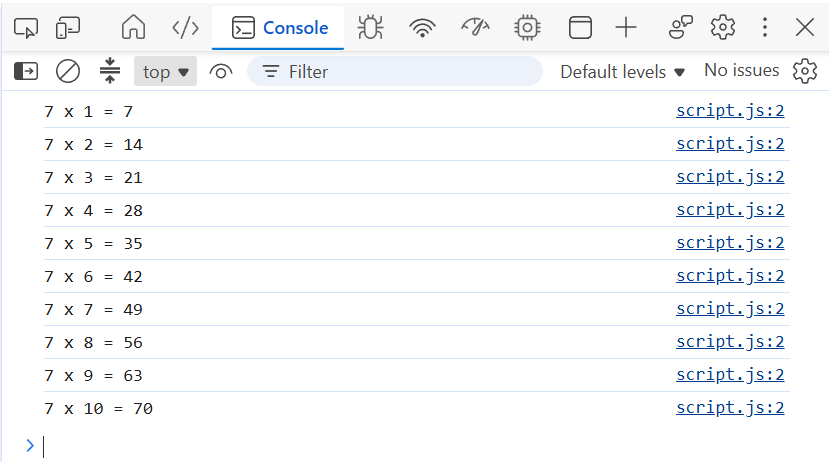

<h4>Buat function cekGenap(angka) yang mengembalikan true jika angka genap</h4>

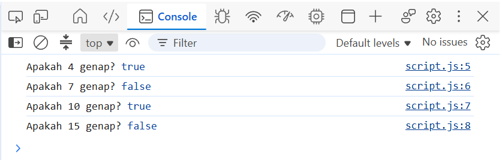

<h4>Tambahkan validasi form agar kolom tidak boleh kosong</h4>

<h4>Ubah Latihan 8 dengan menambah minimal dua pilihan menu dan harga</h4>

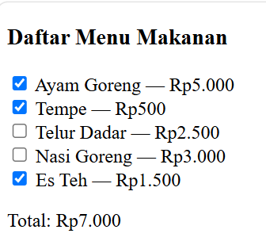

<h4>Gunakan tombol untuk menyembunyikan atau menampilkan elemen HTML</h4>

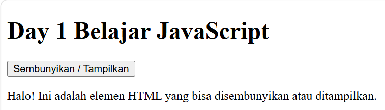

# Praktikum 5 JavaScript

# H. Pertanyaan dan Tugas

# 1. Jelaskan perbedaan console.log(), alert(), prompt(), dan textContent/innerHTML.

- `console.log()` digunakan untuk menampilkan informasi atau hasil program pada Console browser.
- `alert()` digunakan untuk menampilkan pesan dalam kotak dialog.
- `prompt()` digunakan untuk meminta pengguna memasukkan data melalui kotak dialog.
- `textContent` digunakan untuk mengubah atau mengambil teks di dalam elemen HTML tanpa memprosesnya sebagai HTML.
- `innerHTML` digunakan untuk mengubah atau mengambil isi elemen HTML, termasuk tag HTML di dalamnya.

# 2. Apa perbedaan let dan const? Berikan contoh.

`let` digunakan untuk membuat variabel yang nilainya dapat diubah, sedangkan `const` digunakan untuk membuat variabel yang tidak dapat ditetapkan ulang setelah diinisialisasi.

Contoh:

\javascript
let umur = 20;
umur = 21;
console.log(umur); // 21

const nama = "Andi";
console.log(nama); // Andi
\

# 3. Apa perbedaan operator == dan ===?

Operator `==` membandingkan dua nilai dengan memungkinkan konversi tipe data secara otomatis, sedangkan `===` membandingkan nilai sekaligus tipe datanya tanpa konversi tipe otomatis.

Contoh:

\javascript
console.log(5 == "5");  // true
console.log(5 === "5"); // false
\

Hasil pertama adalah `true` karena tipe data dapat dikonversi, sedangkan hasil kedua adalah `false` karena tipe datanya berbeda.

# 4. Jelaskan fungsi if-else dan switch. Kapan masing-masing dapat digunakan?

`if–else` digunakan untuk menjalankan kode berdasarkan kondisi tertentu, misalnya menentukan kelulusan berdasarkan nilai mahasiswa.

Contoh:

\javascript
let nilai = 80;

if (nilai >= 60) {
    console.log("Lulus");
} else {
    console.log("Tidak lulus");
}
\

`switch` digunakan untuk memilih tindakan berdasarkan beberapa nilai tertentu, misalnya memilih menu program.

Contoh:

\javascript
let pilihan = 2;

switch (pilihan) {
    case 1:
        console.log("Menu satu");
        break;
    case 2:
        console.log("Menu dua");
        break;
    default:
        console.log("Pilihan tidak tersedia");
}
\

# 5. Apa fungsi parameter dan return dalam function?

Parameter adalah variabel yang digunakan untuk menerima data masukan ketika fungsi dipanggil. `return` digunakan untuk mengembalikan hasil dari fungsi kepada bagian kode yang memanggilnya.

Contoh:

\javascript
function tambah(a, b) {
    return a + b;
}

const hasil = tambah(5, 3);
console.log(hasil); // 8
\

Parameter `a` dan `b` menerima nilai 5 dan 3, kemudian `return` mengembalikan hasil penjumlahan, yaitu 8.

# 6. Bagaimana JavaScript memilih elemen HTML menggunakan document.getElementById()?

`document.getElementById()` digunakan untuk memilih elemen HTML berdasarkan atribut `id`. Setelah elemen ditemukan, JavaScript dapat mengubah teks, gaya, atau isi elemen tersebut.

Contoh HTML:

\html

Teks awal

\

Contoh JavaScript:

\javascript
document.getElementById("pesan").textContent = "Halo Dunia!";
\

Kode tersebut memilih elemen dengan `id="pesan"` dan mengubah teksnya menjadi "Halo Dunia!".

# 7. Buat script untuk memvalidasi form agar nama tidak kosong dan nilai berada pada rentang 0–100.

**Kode HTML (`index.html`):**

\html
<!DOCTYPE html>
<html lang="id">
<head>
    <meta charset="UTF-8">
    <meta name="viewport" content="width=device-width, initial-scale=1.0">
    <title>Validasi Form Mahasiswa</title>
</head>
<body>
    <h2>Form Nilai Mahasiswa</h2>

    <form id="formMahasiswa">
        <label for="nama">Nama:</label>
        <input type="text" id="nama">
          

        <label for="nilai">Nilai (0–100):</label>
        <input type="number" id="nilai">
          

        <button type="submit">Periksa</button>
    </form>

    

    
</body>
</html>
\

**Kode JavaScript (`script.js`):**

\javascript
document.getElementById("formMahasiswa").addEventListener("submit", function(event) {
    event.preventDefault();

    const nama = document.getElementById("nama").value.trim();
    const inputNilai = document.getElementById("nilai").value;
    const nilai = Number(inputNilai);
    const pesan = document.getElementById("pesan");

    if (nama === "") {
        pesan.textContent = "Nama tidak boleh kosong!";
    } else if (
        inputNilai.trim() === "" ||
        !Number.isFinite(nilai) ||
        nilai < 0 ||
        nilai > 100
    ) {
        pesan.textContent = "Nilai harus berada pada rentang 0–100!";
    } else {
        pesan.textContent = "Data valid. Nama: " + nama + ", Nilai: " + nilai;
    }
});
\

**Penjelasan:**

1. `addEventListener("submit", ...)` menjalankan validasi ketika form dikirim.
2. `event.preventDefault()` mencegah form dikirim secara langsung agar validasi dapat dilakukan terlebih dahulu.
3. `trim()` menghapus spasi di awal dan akhir nama sehingga input berupa spasi saja dianggap kosong.
4. Program memeriksa apakah nama kosong dan apakah nilai berada pada rentang 0–100.
5. Jika semua input valid, program menampilkan nama dan nilai pada halaman web.